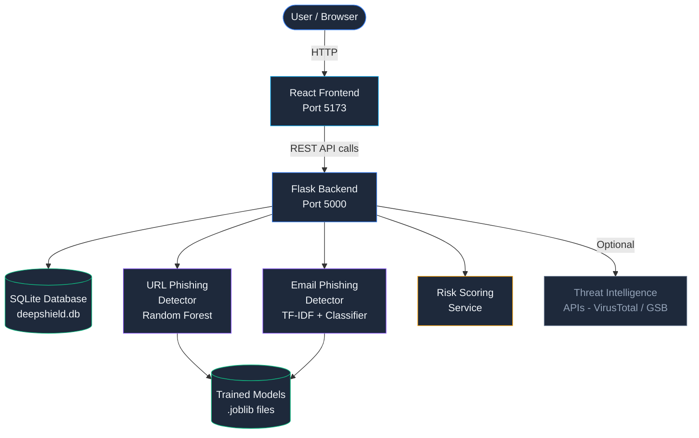
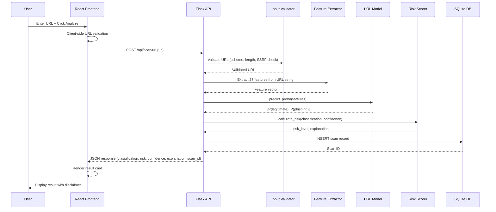
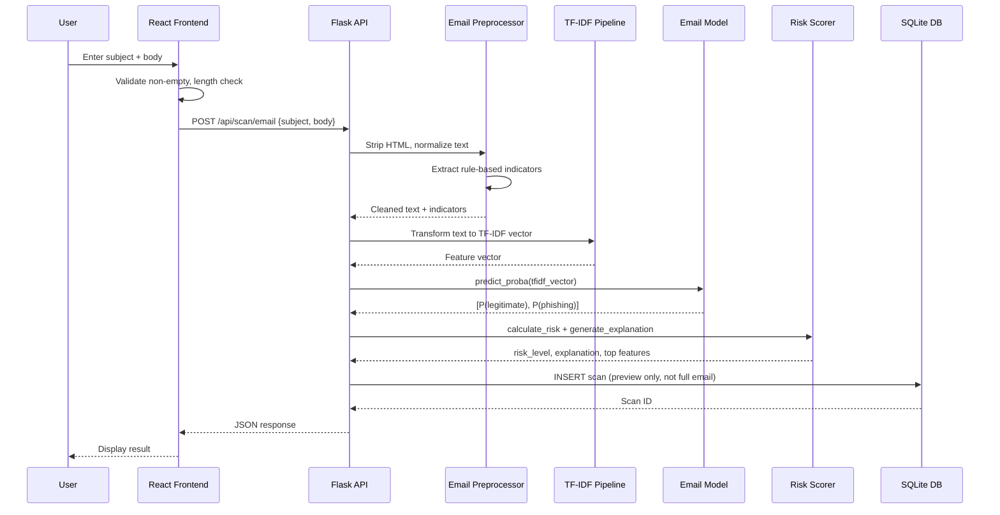
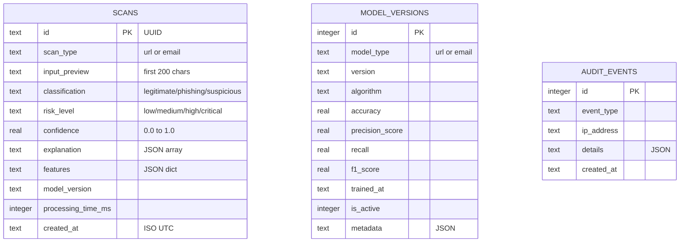

# DeepShield — System Architecture

**Version:** 1.0  
**Date:** 2026-11-01

---

## 1. System Architecture Overview



---

## 2. Directory Structure

```
Deep_sheild_final/
├── frontend/                    # React + Vite application
│   ├── public/
│   ├── src/
│   │   ├── api/                 # Axios client + API functions
│   │   ├── components/          # Reusable UI components
│   │   │   ├── Layout/          # AppLayout, Sidebar, Header
│   │   │   ├── UI/              # Badge, Card, Button, Input...
│   │   │   └── Charts/          # recharts wrappers
│   │   ├── pages/               # Route-level page components
│   │   ├── hooks/               # Custom React hooks
│   │   └── utils/               # Formatters, validators
│   ├── package.json
│   └── vite.config.js
│
├── backend/                     # Flask Python backend
│   ├── app/
│   │   ├── __init__.py          # App factory
│   │   ├── database.py          # SQLAlchemy setup
│   │   ├── models.py            # ORM models
│   │   ├── api/                 # Blueprint endpoints
│   │   │   ├── scan.py          # /api/scan/*
│   │   │   ├── dashboard.py     # /api/dashboard/*
│   │   │   ├── analytics.py     # /api/analytics
│   │   │   ├── models_api.py    # /api/models/*
│   │   │   └── health.py        # /api/health
│   │   ├── ml/                  # Machine learning layer
│   │   │   ├── url_features.py  # URL feature extraction
│   │   │   ├── email_features.py # Email NLP features
│   │   │   ├── predictor.py     # Model inference
│   │   │   ├── risk_scorer.py   # Risk assessment
│   │   │   └── models/          # Saved .joblib models
│   │   └── security/
│   │       └── middleware.py    # Rate limiting, headers
│   ├── tests/                   # Backend test suite
│   └── main.py                  # Entry point
│
├── datasets/                    # Training datasets
│   ├── url/                     # URL phishing dataset
│   └── email/                   # Email phishing dataset
│
├── scripts/                     # Training and utility scripts
│   ├── generate_url_dataset.py
│   ├── generate_email_dataset.py
│   ├── train_url_model.py
│   ├── train_email_model.py
│   └── run_training.py
│
├── research/
│   ├── notebooks/               # Analysis documentation
│   └── results/                 # Evaluation outputs
│
├── documentation/
│   ├── diagrams/                # Architecture diagrams
│   └── project_report/          # Academic report
│
├── PROJECT_AUDIT.md
├── IMPLEMENTATION_PLAN.md
├── ARCHITECTURE.md
├── SECURITY.md
├── README.md
├── INSTALLATION_GUIDE.md
└── .gitignore
```

---

## 3. Request/Response Flow

### URL Scan Flow



### Email Scan Flow



---

## 4. Database Entity Relationship



---

## 5. Machine Learning Architecture

### URL Detection Pipeline

```
Raw URL String
     ↓
URL Parser (urllib.parse)
     ↓
Feature Extractor (27 features)
     ↓
StandardScaler
     ↓
Classifier (Random Forest / best CV model)
     ↓
predict_proba() → [P(legit), P(phish)]
     ↓
Risk Scorer → risk_level
     ↓
Feature Importance → Explanation
```

### Email Detection Pipeline

```
Subject + Body Text
     ↓
HTML Stripper (re.sub)
     ↓
Text Normalizer (lowercase, whitespace)
     ↓
Rule Engine → suspicious indicators dict
     ↓
TF-IDF Vectorizer (max_features=5000, ngram=(1,2))
     ↓
Classifier (Logistic Regression / best CV model)
     ↓
predict_proba() → [P(legit), P(phish)]
     ↓
Risk Scorer + Top Features → Explanation
```

---

## 6. Security Architecture

```mermaid
graph LR
    Input([User Input]) --> RateL[Rate Limiter<br/>30 req/min per IP]
    RateL --> SizeL[Request Size Limit<br/>URL: 2KB / Email: 50KB]
    SizeL --> Val[Input Validator<br/>Schema validation]
    Val --> Sanitize[Input Sanitizer<br/>Strip null bytes, encode]
    Sanitize --> Logic[Business Logic]
    Logic --> OutEnc[Output Encoder<br/>JSON serialization]
    OutEnc --> SecH[Security Headers<br/>CSP, XCTO, XFO]
    SecH --> Client([Client Response])
```



**Security measures implemented:**
- Rate limiting (in-memory sliding window, 30 req/min per IP)
- Input validation (Werkzeug + custom validators)
- Output encoding (JSON only, no raw HTML output)
- CORS restricted to known origins
- No automatic URL fetching (SSRF prevention)
- No email attachment execution
- Parameterized DB queries via SQLAlchemy ORM
- Security headers on all responses
- Audit logging for all scan events
- Environment variables for all secrets

---

## 7. Component Interaction Matrix

| Component | Talks To | Protocol |
|-----------|----------|----------|
| React Frontend | Flask Backend | HTTP REST + JSON |
| Flask Backend | SQLite | SQLAlchemy ORM |
| Flask Backend | URL Model | joblib in-process call |
| Flask Backend | Email Model | joblib in-process call |
| URL Model | Feature Extractor | Python function call |
| Email Model | TF-IDF Pipeline | sklearn pipeline |
| Risk Scorer | Predictor | Python function call |
| Audit Logger | SQLite | SQLAlchemy ORM |

---

## 8. Deployment Topology

```
[User Browser]
      |
      | HTTP on port 5173
      |
[Vite Dev Server / Built Static Files]
      |
      | HTTP proxy /api/* to port 5000
      |
[Flask Development Server]
      |
      |--- SQLite file (backend/deepshield.db)
      |--- ML models (backend/app/ml/models/*.joblib)
      |--- Logs (backend/logs/deepshield.log)
```

---

*Architecture reflects actual implementation. Updated as system evolves.*

